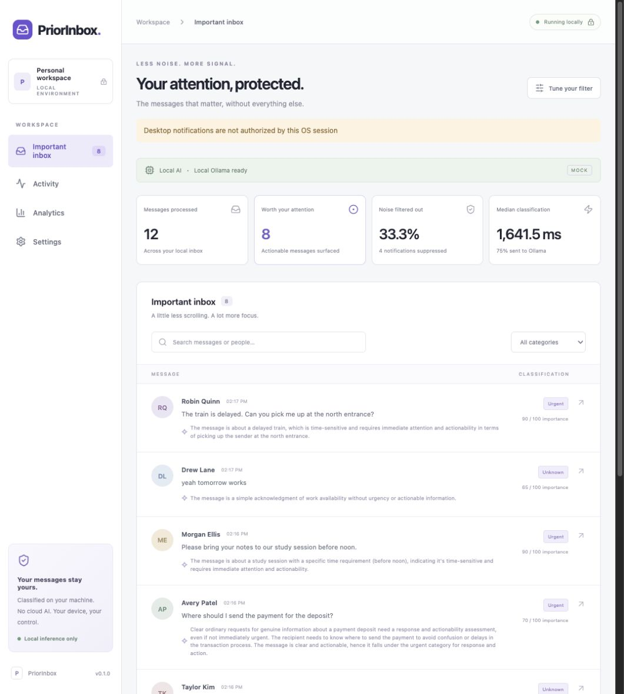
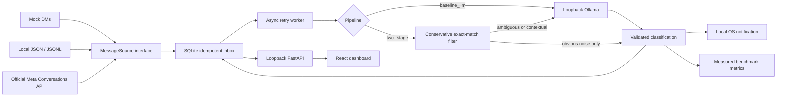

<div align="center">

# PriorInbox

**Your attention, protected.**

Privacy-first local AI message triage powered by Ollama.

FastAPI · React · SQLite · Local inference · MIT

</div>

PriorInbox separates actionable messages from casual noise, explains its decisions,
and raises local desktop notifications. Run a synthetic inbox without Instagram,
import your own messages, or connect an eligible Instagram professional account
through Meta's official API.

**Status:** working local MVP with 47 passing automated tests and real local Ollama
benchmarks on 210 synthetic messages. Results and evaluation limits are below.
Instagram is experimental and not live-account verified. Desktop delivery requires
OS authorization; it was denied for the development Python app on macOS.
Fixture mode is a UI and integration demonstration, not an AI evaluation.

## See it locally

Requirements: Python **3.12+**, Node **22+**, [uv](https://docs.astral.sh/uv/), and Make.
Linux/macOS are the primary development targets. On Windows use equivalent commands
in the Makefile; desktop notification support depends on your OS/session.

```bash
git clone https://github.com/its-samgh/priorinbox.git
cd priorinbox
make install
cp .env.example .env
make fixture
```

Open **http://127.0.0.1:5173**. This starts both servers and feeds 12 fictional DMs
through deterministic fixture verdicts. No Ollama or Instagram credentials are needed.
Ctrl-C stops both services. Fixture data has its own local database. To replay an
already processed demo, stop the app and remove only `data/fixture.sqlite3`.

For actual local inference:

```bash
# Install Ollama from https://ollama.com first.
# Set this on the Ollama SERVER process, not just PriorInbox:
OLLAMA_NO_CLOUD=1 ollama serve
# In another terminal; explicit download, typically several GB:
ollama pull qwen2.5:3b
make doctor
make demo
```

If Ollama already runs as a desktop service, configure its environment to disable
cloud functionality rather than starting a second server. `qwen2.5:3b` is a modest
starting model, not a claim of optimal accuracy. Any installed local model that
supports structured output can be configured. There are no automatic downloads,
hosted inference fallbacks, API keys for AI providers or outgoing reply actions.

### Dashboard screenshot



Captured from `make demo`: 12 invented messages classified using local qwen2.5:3b.
The MOCK badge identifies synthetic ingestion; inference and latency are real. The
notification warning records the actual OS permission failure. Never capture or commit
private messages. A [fixture-only screenshot](docs/screenshots/fixture-inbox.jpg) is
also included; its verdicts and timing are not AI results.

## What is included

- **Important inbox:** sender, time, message, importance score, category and explanation.
- **Activity:** recent results, pending/error state, model and measured classification latency.
- **Analytics:** counts, suppressed notification decisions, inference calls, p50/p95,
  and precision/recall/F1 only when local labels exist.
- **Settings:** model, threshold, poll interval, context size, pipeline and notification privacy.
- **Local labeling:** binary feedback in the inbox, full category labeling via CLI.
- **Two comparable pipelines:** `baseline_llm` and `two_stage`, sharing the same model,
  validated schema, threshold and limited context.

## Architecture



FastAPI owns one sequential worker and database. The dashboard uses a same-origin
Vite proxy. Message source + external ID is unique across restarts. Classification
commits before notification; a crash in between can lose a notification, but a
replayed message is not classified/notified again. Do not run multiple worker processes.
See [design decisions](docs/design.md).

### Example flow

`“Can you send the file before 6?”` → not an obvious reaction → recent conversation
context + message sent to local Ollama → JSON schema validation → threshold applied
→ stored result → local notification if enabled.

A result could have category `time_sensitive_request`, `requires_response: true`
and an explanation such as “File requested before a deadline.” Scores come from the
model; they are not calibrated probabilities. Malformed output is retried up to
three times with backoff, then shown as an error and retained for later retry.
An error is never silently classified as casual.

`lol` with no context is eligible for the first-stage filter. `lol` following a
serious conversation, `okay`, `👍`, and “yeah tomorrow works” go to the model.
Turning context off trades recall for less input; no heuristic guarantees zero
false negatives. Long prior messages are bounded to 2,000 characters each.

## Privacy guarantees

Classification uses only `http://localhost:11434` (configurable **loopback-only**).
No OpenAI, Anthropic, Gemini or hosted inference clients exist. Cloud model names
and remote aliases are rejected. PriorInbox does not transmit message content for
telemetry, analytics or error reporting. Trust your local Ollama service and disable
its cloud functionality with `OLLAMA_NO_CLOUD=1`.

When Instagram ingestion is enabled, your computer **necessarily contacts Meta**
using your authorized token to retrieve account conversations/messages. Instagram
already hosts those messages; Instagram itself is not local or private. The
subsequent PriorInbox classification, storage and dashboard remain local.

Persistent mode stores message bodies, sender information, results, reasons and
labels in local SQLite. Set `PRIOR_PERSIST_RAW=false` before startup for an entirely
in-memory session, including settings and deduplication. Restart forgets everything
in that mode. It does not delete an existing database. Storage is not encrypted;
use OS disk encryption if needed. Notification previews are off by default.

Private inputs, exports, tokens, databases and benchmark outputs are gitignored.
Only invented public fixtures are committed. No raw message logging is enabled.
Browser/OS history, backups, swap and other local software remain outside these
controls. See [SECURITY.md](SECURITY.md) for the threat model and limitations.

For a built frontend served directly by FastAPI, use `make serve` and open
http://127.0.0.1:8000. This respects `.env` source/settings and avoids a Vite dev server.
Stop any existing demo first so port 8000 is available.

## Instagram integration

Only **Professional Business or Creator** accounts with the necessary Meta
permissions are eligible. Personal accounts are unsupported. This project uses
Instagram Login, not Facebook Login, with `instagram_business_basic` and
`instagram_business_manage_messages`. Developer roles, Advanced Access/App Review,
business verification and message-access settings may be required for your use case.

Read the [setup guide and current documentation links](docs/instagram.md) before
configuring local environment credentials. No OAuth UI/token refresher is included.
The adapter uses official read endpoints with cursor pagination, bounded backoff,
rate-limit handling and outbound-message exclusion. It is **not yet verified with a
live account**. Polling is best effort; recent-message limits can cause gaps during
bursts or outages. There is no webhook receiver or unsupported personal-account
workaround. Use mock/file ingestion if you cannot obtain supported API access.

## Local files and exported messages

Use `PRIOR_SOURCE=file` and place normalized JSON arrays/JSONL in `data/incoming/`.
Start the API directly (demo commands intentionally select mock ingestion):

```bash
.venv/bin/python -m uvicorn backend.app.main:app --host 127.0.0.1 --port 8000 --no-access-log
npm --prefix frontend run dev
```

Example normalized row (invented):

```json
{"external_id":"sample-1","conversation_id":"alex-thread","sender_id":"alex","sender_display_name":"Alex","text":"Can you send the file?","timestamp":"2026-01-01T12:00:00Z","source":"file"}
```

Files are replayed; IDs prevent duplicates. Maximum file size is 20 MB and message
text is limited to 16,000 characters. Unsupported/invalid records are reported without
logging their contents. Export formats can change. A converter supports the common
Meta JSON `messages` / `sender_name` / `timestamp_ms` layout:

```bash
.venv/bin/python -m scripts.import_export exports/message_1.json \
  --self-name 'Your exact exported name' --output data/incoming/export.jsonl
.venv/bin/python -m scripts.label data/incoming/export.jsonl
```

The labeler resumes by ID and writes only to the ignored private dataset by default.
Inspect timestamps/encoding and conversation IDs when importing. Media is represented
as a review placeholder; it is not analyzed. Outgoing context is not currently
retained by the export/Instagram adapters. You can provide explicit context in a
benchmark dataset for evaluating conversations with both directions.

## Benchmarking methodology

The public [synthetic dataset](benchmarks/data/README.md) contains **210 invented
English examples**, including requests, spam, reactions and contextual counterexamples.
Every row carries a binary label, category and frozen context. Labels never enter
the model prompt. Both pipelines use the same configuration and data hash. Reports also record the
local model digest, Ollama version and classifier code hash, which must match.

```bash
.venv/bin/python -m benchmarks.run \
  --dataset benchmarks/data/synthetic.jsonl --pipeline baseline_llm
.venv/bin/python -m benchmarks.run \
  --dataset benchmarks/data/synthetic.jsonl --pipeline two_stage
# Or: make benchmark
make resume-metrics
```

Outputs, all gitignored:

```text
benchmarks/results/baseline.json
benchmarks/results/two_stage.json
benchmarks/results/comparison.md
benchmarks/results/resume-bullets.txt
```

For your own data, pass `--dataset benchmarks/data/private/labeled.jsonl` to both
runs. Private results are described as a “locally labeled dataset,” without filenames
or message contents. Results contain aggregates, settings, machine/runtime metadata,
a dataset hash and provenance, never raw messages or reasons.

- **Latency:** end-to-end classification duration, including retries/backoff; p50/p95
  use linear interpolation. Total inference time records HTTP round-trip time.
- **Throughput:** successful messages divided by measured sequential run wall time.
  Startup/model validation is excluded; first-generation model loading is included.
- **Calls:** HTTP chat attempts, including retries; separately count messages routed
  to Ollama and the percentage bypassing it via the heuristic.
- **Quality:** precision TP/(TP+FP), recall TP/(TP+FN), F1 2TP/(2TP+FP+FN), and
  false-negative rate FN/(TP+FN). Undefined denominators are N/A, never invented zeros.
- **Notification reduction:** suppressed classifications / processed messages, compared
  with notifying on every message. This is a decision metric, not OS delivery success.
- Incomplete runs retain failure counts and cannot produce a paired comparison or
  resume bullets. Fixture runs can verify the machinery but cannot produce resume claims.

Single runs have uncontrolled model warm state and CPU/GPU contention. Repeat runs
in alternating order into separate `--output-dir` directories; retain each run.
Report hardware, model/version, threshold, sample size and variability. Do not claim
causality from tiny timing changes. Synthetic English results do not establish
real-world quality; evaluate a separately labeled holdout set for that.

### Actual benchmark results

Measured on an Apple M1 Pro MacBook Pro with 16 GB RAM on 2026-10-05, using
`qwen2.5:3b`, threshold 0.65 and up to four context messages.

Development note: the initial score guidance measured 60% recall at the 0.65 threshold.
Diagnostics showed ordinary information questions being treated as casual. The revised
guidance explicitly distinguishes actionability from urgency and gives score ranges.
The same public set informed this debugging, so the table is a development challenge
result, **not held-out validation**. The original pair is retained locally under
`benchmarks/results/initial-prompt/`. Evaluate a separately labeled holdout before
claiming real-world accuracy.

<!-- benchmark-results:start -->
# Measured pipeline comparison

Dataset: synthetic; N=210; model: qwen2.5:3b.
Single sequential runs; model warm state uncontrolled. Repeat in alternating order.

Ollama version: 0.34.4; model digest: `357c53fb659c5076de1d65ccb0b397446227b71a42be9d1603d46168015c9e4b`.
Classifier SHA-256: `3327e0cddda946ee83a61785888b2b63c7a70b9b4abd5423c59b4c670fd9d9d8`.
Machine: Darwin arm64; Python 3.14.7.

| Metric | Baseline | Two-stage |
|---|---:|---:|
| messages_processed | 210.00 | 210.00 |
| llm_calls | 210.00 | 201.00 |
| filtered_before_llm_pct | 0.00 | 4.29 |
| total_inference_ms | 353257.56 | 341436.68 |
| p50_latency_ms | 1520.42 | 1529.20 |
| p95_latency_ms | 2487.37 | 2435.86 |
| throughput_per_second | 0.59 | 0.61 |
| precision | 0.95 | 0.95 |
| recall | 0.86 | 0.86 |
| f1 | 0.90 | 0.90 |
| false_negative_rate | 0.14 | 0.14 |
| notification_reduction_pct | 31.43 | 31.43 |

Ollama call reduction: 4.29%.
p95 latency reduction: 2.07%.
Throughput ratio: 1.03×.
Notification reduction is versus notifying on every message, not versus baseline.
Precision, recall, F1 and false-negative rate are fractions. N/A is undefined.
<!-- benchmark-results:end -->

`comparison.md` is generated automatically from the two measured result files.
Run `.venv/bin/python -m scripts.publish_metrics` to copy a complete real synthetic
comparison into the section above. Private and fixture reports are refused. Resume
bullets use only measured values and explicitly identify synthetic vs locally
labeled data; they do not claim improvements when a metric regresses.

## Development and verification

```bash
make test       # mocked Ollama and Meta; no credentials or service required
make lint       # Ruff + frontend formatting
make typecheck  # mypy + TypeScript
make build      # production frontend bundle
```

CI runs Python 3.12/Node 22 with locked dependencies. Tests cover schemas, malformed
model output, thresholds, conservative filtering, context, deduplication/restarts,
file/Meta adapters, API security/settings/labels and benchmark mathematics. Frontend
tests cover fixture provenance, missing metrics, settings saves and backend failures.
See [validation record](docs/validation.md) for commands actually executed locally.

```text
backend/app/    classifier · ingestion · models · notifications · services · API
backend/tests/ mock-based backend and benchmark tests
frontend/      React/TypeScript dashboard, Vite and component tests
benchmarks/    sequential runner, comparison, public synthetic dataset
scripts/       demo supervisor, doctor, private importer/labeler, metric publication
docs/          design, Instagram limitations, validation
```

## Roadmap and known limitations

- Live Meta account validation, token lifecycle management and optional signed webhooks.
- Better conversation context, including outbound messages and multimedia metadata.
- Retention controls, schema migrations, encrypted storage and large-inbox indexing.
- Independent multilingual labels, held-out evaluations and repeated-run uncertainty.
- Packaged desktop distribution and verified notification behavior on each OS.

The current API scans stored rows for analytics/context and the UI shows the latest
500 messages. This is suitable for a local prototype, not an unbounded archive.
One worker is supported. OS notification delivery is best effort, dependent on OS
permissions/session support. Stopping the backend pauses monitoring. This is not an
emergency monitoring system. Scores can be wrong; keep reviewing your source inbox.

## Public repository

[its-samgh/priorinbox](https://github.com/its-samgh/priorinbox) is published publicly
with the MIT license, GitHub Actions and issue templates. Contributions are welcome;
see [CONTRIBUTING.md](CONTRIBUTING.md).
